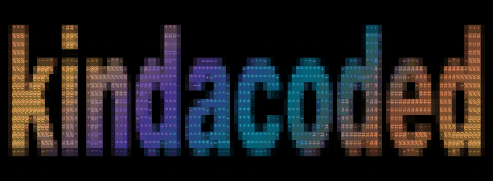

  

<h4 align="center">I build terminal toys, small tools and whatever sounds fun at 2 am.</h4>

  <a href="https://github.com/kindacoded/chromascii">chromascii</a> |
  <a href="https://github.com/kindacoded/terminal-spin">terminal-spin</a>

 

## Projects

| | Project | What it does |
|---|---|---|
| 🌈 | **[chromascii](https://github.com/kindacoded/chromascii)** | Play any video or GIF as full-color ASCII art in your terminal, or export it as an MP4 with the original sound. The banner above was drawn with it. |
| 🧊 | **[terminal-spin](https://github.com/kindacoded/terminal-spin)** | Turn any SVG logo into a real 3D spinning background for Windows Terminal, rendered in Blender, in one command. |

## Tools I use

## Right now

- Making the terminal prettier than it has any right to be.
- Turning short videos into ASCII art.
